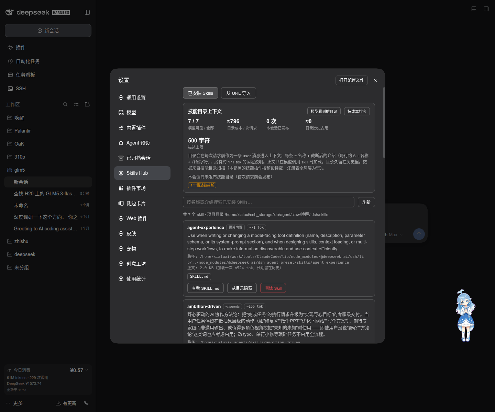
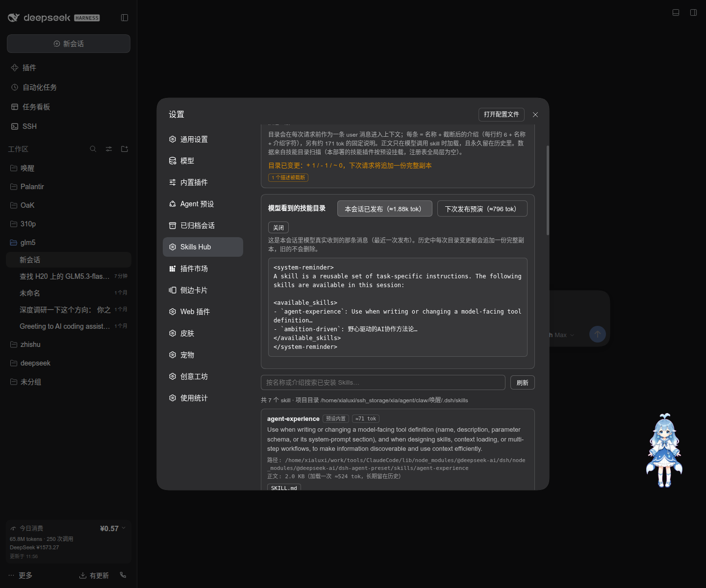
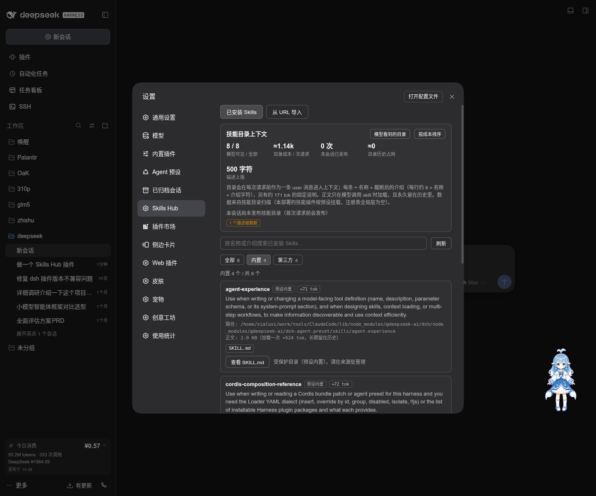

<p align="center"></p>

<h1 align="center">Skills Hub · 技能中枢</h1>

<p align="center">看清每个 Skill 在模型上下文里到底花了多少，并把不需要的从目录里摘掉——文件不删。</p>

<p align="center">
  
  
  
</p>

<p align="center">
  
</p>

## 它解决什么问题

Skill 不是免费的。它对上下文的影响有三层，而 DSH 只把结果给你、不把账单给你：

| 层 | 何时付费 | 现象 |
| --- | --- | --- |
| **目录行** | **每一次请求** | 每个 skill 的 `名称 + 截断后的介绍` 都在系统提示里 |
| **目录副本** | 每次目录变更追加一份完整副本 | 改一次 skill，历史里就多一份完整目录，旧的不删 |
| **正文** | 模型调用 skill 时加载一次 | 之后永久留在历史里 |

Skills Hub 把这三层逐项量化，并给你一个不破坏文件的减负开关。

## 功能

- **真实目录成本**：按 DSH 的渲染规则逐字计算（`- \`name\`: description`，空白归一化后按 `catalogDescriptionMaxLength` 截断，默认 500 字符）。token 为估算值（CJK ≈ 1.1/字，其余 ≈ 4 字符/token）。
- **模型实际看到的目录**：面板给出两个版本——**本会话已发布**（从会话里真实的 `skill-catalog` 消息取出，与模型收到的那条**逐字一致**）与**下次发布预演**（按当前配置推算，同样逐字对齐 DSH 模板）。
- **目录漂移告警**：当前技能集合与会话已发布的那份不一致时，提示「目录已变更：+ / - / ~，下次请求将追加一份完整副本」。
- **一键减负**：「从目录隐藏」写入 `disable-model-invocation: true`，文件保留、`/名字` 仍可手动调用，但不再进入模型目录，成本立刻归零。
- **分类筛选**：`全部` / `内置` / `第三方`（内置 = 随 DSH、插件或 Agent 预设安装，只读；第三方 = 装在项目或用户目录，可改可删），带数量、可与搜索叠加。
- **为什么模型看不到它**：DSH 对无效 frontmatter 是静默跳过的。面板列出磁盘上存在却没进目录的技能及原因（缺 frontmatter、name 非 kebab-case、布尔值非法、同名被高优先级目录覆盖）。
- **从 URL 导入**：ClawHub `clawhub.ai/<owner>/<skill>`、Skills.sh `skills.sh/<owner>/<repo>/<skill>`、GitHub `github.com/<owner>/<repo>[/tree/<branch>/<path>]`，文件由服务端拉取。
- **卸载**：两步确认，仅删除该 skill 的文件，不影响插件本体。

<p align="center">
  
  <br>
  
</p>

> 本插件不注册任何模型工具或技能，自身对上下文的固定占用为 **0 token**。

## 安装

### 从 GitHub 安装（推荐）

```bash
dsh plugin --profile web add git+https://github.com/xiatian-wuhan/dsh-skills-hub.git
```

固定到某个提交（可复现）：

```bash
dsh plugin --profile web add "git+https://github.com/xiatian-wuhan/dsh-skills-hub.git#<commit>"
```

安装后重启 `dsh web`，打开 **设置 → Skills Hub**。

### 通过插件市场索引

本仓库同时是一份 DSH 插件市场索引（format 1）。在 DSH 里：

```
插件 → Discover → 索引源 → 添加
https://xiatian-wuhan.github.io/dsh-skills-hub/index.json
```

或让 agent 使用 `plugin_market` 工具检索该索引。

## 使用提示

- 打开面板先看顶部「目录成本 / 次请求」；点「按成本排序」找出最贵的 skill。
- 描述被标「截断」的 skill，模型只看到前 `上限-3` 个字符——把介绍写短比写全更有用。
- 长期不用又不想删的 skill，点「从目录隐藏」：成本归零，文件与 `/名字` 调用都保留。
- 「本会话已发布 N 次」数字越大，说明目录变动越多，历史里的目录副本也越多。

## 兼容性

- 需要 **DSH ≥ 0.2.0**（使用 `ctx.shell` 的 `execute()` 接口；0.1.x 的 `run()` 仍做了兼容）。
- Web 组合里 `dsh-base` 的全局 `skill-filesystem` / `tool-skill` 被 `dsh-web-app` 关闭，技能实际由 **Agent 预设作用域**提供。因此本插件按官方规则自行扫描 project / preset / user 各技能根，并与会话里已发布的目录交叉校验；若某部署的全局 `ctx.skills` 有内容，会自动作为覆盖层合入。

## 开发

```bash
# 生成市场索引（提交代码后运行，写入 docs/index.json）
node scripts/make-index.mjs

# 本地安装调试
dsh plugin --profile web add /absolute/path/to/dsh-skills-hub
```

仓库结构：`index.js` 是 Host 半区（HTTP 路由 + 扫描 + 成本计算），`client.js` 是浏览器半区（设置面板），`cordis.patch.yml` 声明要注入的服务。

## English

**Skills Hub** shows what every installed skill costs in the model's context — the always-present catalog line, the full catalog copy appended on each change, and the body loaded on first use — and lets you hide a skill (`disable-model-invocation`) without deleting it. It also previews the exact catalog message the model receives (byte-identical to what `dsh-tool-skill` publishes), flags descriptions truncated by the catalog cap, and reports skills that exist on disk but never reach the catalog.

Install: `dsh plugin --profile web add git+https://github.com/xiatian-wuhan/dsh-skills-hub.git`, then restart `dsh web` and open **Settings → Skills Hub**. Requires DSH 0.2.0+.

## License

MIT
